# Блокнот встреч — мобильное приложение для заметок

Учебный проект производственной (технологической) практики, кейс-задачи № 4 и № 5.
Приложение для записей на совещаниях, собраниях, конференциях и деловых встречах: создание, изменение,
удаление и поиск заметок по словам, дате, времени и типу мероприятия.

**Открыть приложение:** https://kerim2626.github.io/meeting-notes-pwa/
**Тесты в браузере:** https://kerim2626.github.io/meeting-notes-pwa/tests/

## Что это за приложение

Прогрессивное веб-приложение (PWA): одна кодовая база для Android, iOS и компьютера. Его можно добавить
на главный экран как обычное приложение. Оно открывается в отдельном окне без адресной строки и после первого
запуска работает без интернета. Магазин приложений и установка из APK не нужны.

| Требование задания | Реализация |
|---|---|
| Создание заметки с заголовком, датой, временем и содержанием | редактор с проверкой полей; дополнительно тип мероприятия, место и участники |
| Редактирование и удаление | изменение любого поля; удаление с подтверждением и кнопкой «Отменить» |
| Поиск по ключевым словам, дате, времени и другим параметрам | все слова запроса без учета регистра (в том числе кириллица и «ё»), диапазон дат, диапазон времени, тип мероприятия |
| Хранение в SQLite | база SQLite в браузере (sql.js, WebAssembly), файл базы хранится в IndexedDB устройства, можно выгрузить `notes.sqlite` |
| Хранение в файловой системе устройства | каждая заметка — отдельный JSON-файл в файловом хранилище приложения (Origin Private File System); в Safari без `createWritable` запись идет через Web Worker |
| Интуитивный интерфейс | нижнее меню из трех разделов, крупные элементы управления (не меньше 44 px), группировка по дням, понятные сообщения |
| Поддержка iOS и Android | PWA работает в Chrome на Android и в Safari на iOS 16 и новее |
| Синхронизация между устройствами | резервная копия JSON: выгрузить на одном устройстве, положить в облачный диск, загрузить на другом |

## Руководство пользователя

### 1. Установка

- **Android (Chrome):** откройте ссылку, нажмите «Установить приложение» в меню ⋮ (или во всплывающей подсказке).
- **iPhone (Safari):** откройте ссылку, нажмите «Поделиться» → «На экран „Домой“» → «Добавить».
- **Компьютер:** приложение работает в любом современном браузере; в Chrome и Edge есть значок установки в адресной строке.

При первом запуске список пуст. Кнопка «+» внизу справа создает заметку.

| Первый запуск | Новая заметка | Проверка полей |
|---|---|---|
| 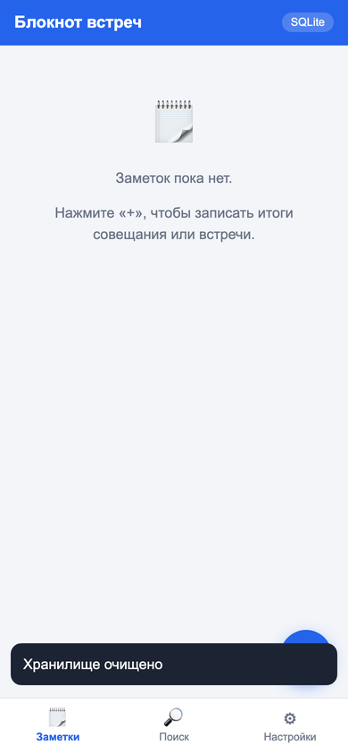 | 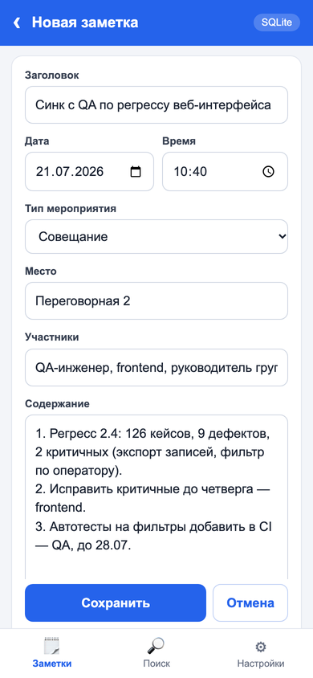 | 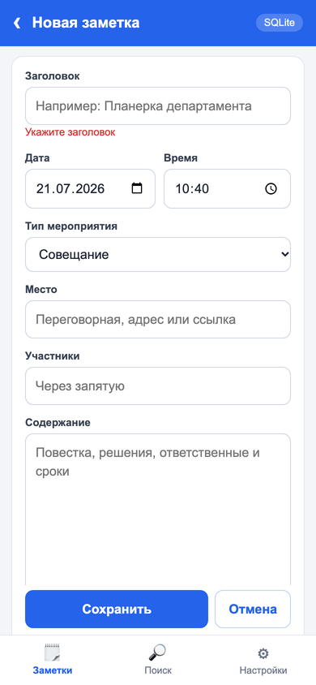 |

### 2. Создание заметки

1. Нажмите «+».
2. Введите заголовок. Дата и время уже заполнены текущими значениями, при необходимости их можно изменить.
3. Выберите тип мероприятия, укажите место и участников.
4. Запишите повестку, решения, ответственных и сроки.
5. Нажмите «Сохранить».

Пока заметка не сохранена, текст автоматически хранится как черновик. Если случайно выйти из редактора,
при следующем открытии приложение предложит восстановить введенное.

### 3. Просмотр, изменение, удаление

Заметки сгруппированы по дням («Сегодня», «Вчера», дата), новые — сверху. Нажмите на карточку, чтобы открыть
заметку. В ней есть кнопки:
- «Изменить»;
- «Поделиться» (системное меню телефона или копирование текста);
- «Файл .md» (сохранить заметку отдельным файлом);
- «Удалить».

После удаления внизу 6 секунд показывается кнопка «Отменить».

| Список по дням | Просмотр | Удаление с отменой |
|---|---|---|
| 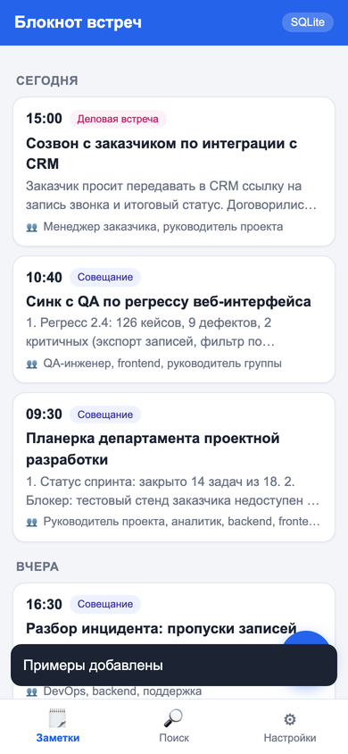 | 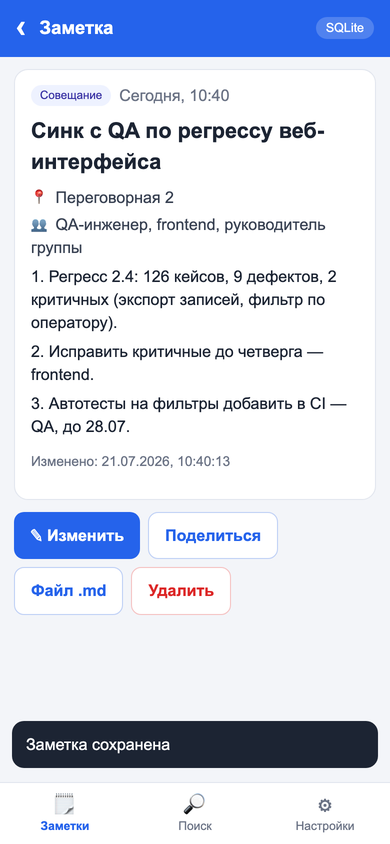 | 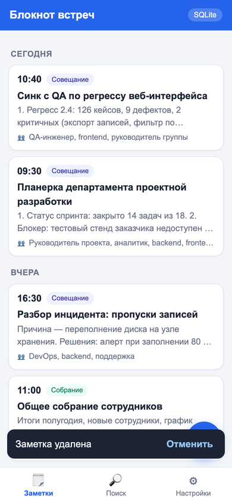 |

### 4. Поиск

Раздел «Поиск» в нижнем меню:
- **ключевые слова** ищутся в заголовке, тексте, месте и списке участников; должны встретиться все слова, регистр не важен;
- **«Дата с / по»** ограничивает период;
- **«Время с / до»** ищет встречи, начавшиеся в этом интервале;
- **«Тип»** — совещание, собрание, конференция, деловая встреча.

Результаты обновляются по мере ввода. «Сбросить фильтры» очищает все условия.

| Поиск по словам | Фильтры времени и типа |
|---|---|
| 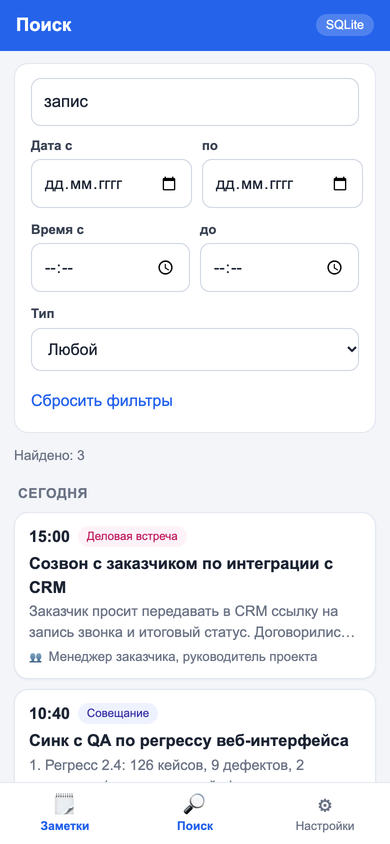 | 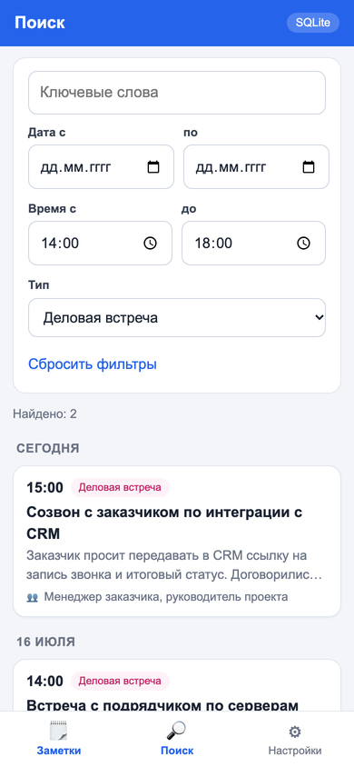 |

### 5. Где хранятся заметки

В разделе «Настройки» выберите хранилище:
- **«База данных SQLite»** (по умолчанию) — все заметки в одной базе, ее можно выгрузить файлом `.sqlite` и открыть, например, в DB Browser for SQLite;
- **«Файлы на устройстве»** — каждая заметка хранится отдельным файлом.

Флажок «Перенести существующие заметки» копирует записи в новое хранилище. Значок вверху справа показывает текущее хранилище.

Там же можно сделать резервную копию или синхронизацию: «Выгрузить JSON» на одном устройстве и «Загрузить JSON» на другом.

| Выбор хранилища | Режим «Файлы» | Резервная копия |
|---|---|---|
| 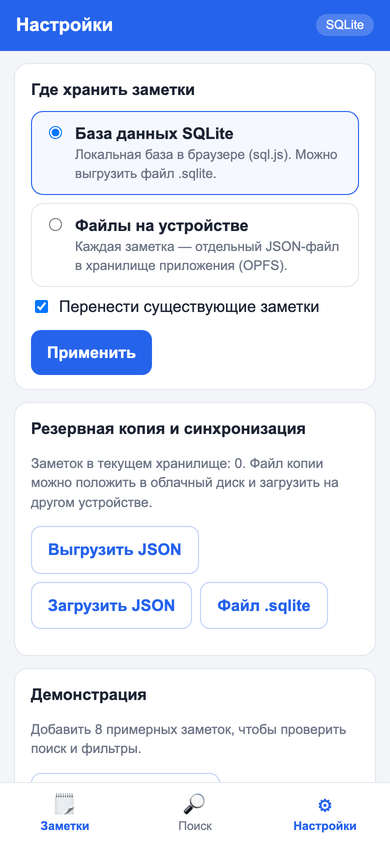 | 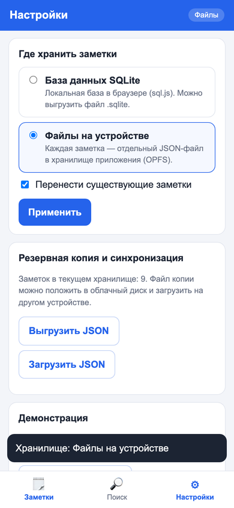 | 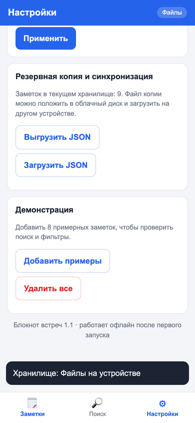 |

## Как проверить приложение (для руководителя практики)

1. Откройте https://kerim2626.github.io/meeting-notes-pwa/ на телефоне или компьютере.
2. В «Настройках» нажмите «Добавить примеры». Появятся 8 заметок за последние 10 дней.
3. **Создание:** «+» → заполните поля → «Сохранить»; попробуйте сохранить без заголовка — появится подсказка.
4. **Поиск:** в «Поиске» введите «сервер» (1 результат), затем очистите поле и задайте «Время с 14:00» и тип «Деловая встреча» (2 результата).
5. **Изменение и удаление:** откройте заметку → «Изменить» → поменяйте время → «Сохранить»; затем «Удалить» и «Отменить».
6. **Хранилища:** «Настройки» → «Файлы на устройстве» → «Применить». Значок сменится на «Файлы», заметки сохранятся. «Файл .sqlite» в режиме SQLite скачивает базу.
7. **Офлайн:** после первого открытия включите режим «В самолете» и перезапустите приложение — оно откроется, заметки на месте.
8. **Автотесты:** откройте `/tests/` — 19 тестов модели и обоих хранилищ выполняются прямо в браузере, внизу будет «Пройдено 19 из 19». Тесты работают в отдельном хранилище и не затрагивают ваши заметки.

## Локальный запуск

```bash
python3 -m http.server 8000      # из корня репозитория
# http://localhost:8000 — localhost считается безопасным контекстом, Service Worker и OPFS работают
```

Зависимостей и сборки нет. Библиотека sql.js 1.10.3 (лицензия MIT) лежит в каталоге `vendor/sql.js`,
поэтому приложение не зависит от доступности CDN; Service Worker кэширует ее для работы без сети.

## Структура

```
index.html, manifest.webmanifest, sw.js   оболочка PWA, манифест, офлайн-кэш
css/app.css                               мобильная верстка
js/app.js                                 экраны и маршрутизация
js/model.js                               модель заметки, проверка, поиск
js/stores/sqlite-store.js, idb.js         хранилище SQLite
js/stores/file-store.js, opfs-worker.js   файловое хранилище
js/demo.js                                примеры заметок
vendor/sql.js/                            SQLite, скомпилированный в WebAssembly (sql.js 1.10.3, MIT)
tests/                                    браузерные тесты
docs/guide/, docs/usability/              руководство и материалы юзабилити-тестирования
```

## История версий

- **1.0 (24.07.2026)** — первая версия для юзабилити-тестирования.
- **1.1 (31.07.2026)** — доработки по итогам тестирования (см. `docs/usability`):
  - автосохранение черновика;
  - отмена удаления;
  - подписи, сброс и счетчик фильтров поиска;
  - подсказка об ошибке скрывается при исправлении поля;
  - подсказка о поиске по участникам.
